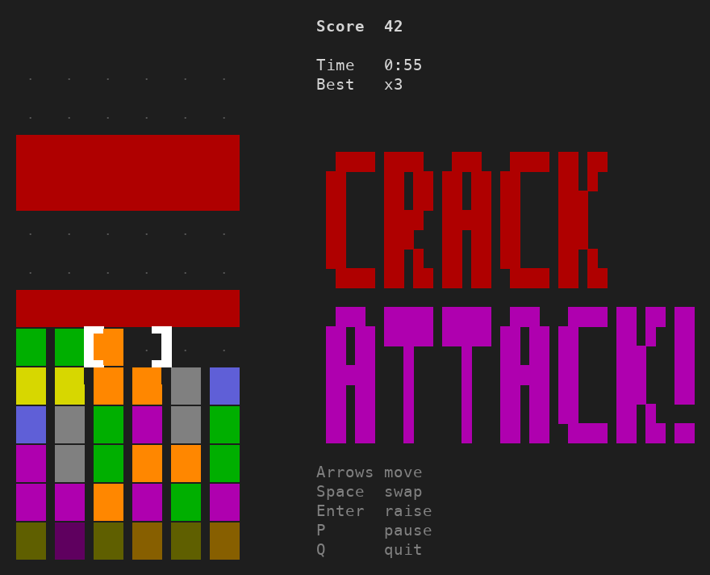

# Crack Attack! over ssh

A Docker image that serves the terminal version of
[Crack Attack!](https://github.com/thiosaur/crackattack) over ssh: connecting starts the game,
and nothing else is reachable.

```
ssh -p 2222 play@your-server
```

<p align="center">
  
</p>

This is the companion of the [main repository](https://github.com/thiosaur/crackattack), which
holds the game, its releases and the terminal version itself.

The image is only packaging. The game itself is downloaded from a release of the main
repository (one small executable) and checked against a pinned SHA-256 before it goes in.

## A personal server, not a public service

This image is meant for your own machine: a homelab, a home server, a few people you know.
**It is not designed to be offered to the public.** Nothing in it deals with load or abuse:
there is no limit per address, no queue, no banning. The only limit is a plain total, `MAX_PLAYERS`
games at once (10 by default), and the container's `pids_limit`, `mem_limit` and `cpus`, which
only keep a mistake from taking the host down. Keep the port on your own network, or behind a VPN.

That is why, with nothing configured, nobody can play: you say whose keys are allowed (below).

## Run it

```sh
docker compose up -d --build
```

The players' keys are **the files of a directory**, `./keys` by default (any file in it, one public
key per line; a name that starts with a dot is not a key). The server reads the directory at each
login, so a file added, edited or removed counts at once, with no restart. A directory with no key
starts the container all the same, and nobody can play until a key is in it.

```sh
mkdir -p keys && cat ~/.ssh/id_ed25519.pub > keys/me    # then: docker compose up -d --build

# another directory (a path on the machine that runs docker)
KEYS_DIR=/srv/crackattack/keys docker compose up -d --build

# the keys you give, instead of the directory (one per line)
AUTHORIZED_KEYS="$(cat ~/.ssh/id_ed25519.pub)" docker compose up -d --build

# anyone who reaches the port, no password asked: only on a network you trust
AUTH_MODE=open docker compose up -d --build
```

A key is one line in the OpenSSH format (`ssh-ed25519 AAAA... comment`), as in `~/.ssh/id_ed25519.pub`.
A public key file that starts with `---- BEGIN SSH2 PUBLIC KEY ----` (some tools write that) is
not read by sshd: convert it with `ssh-keygen -i -m RFC4716 -f key.pub > keys/me`.

Use a directory made for the game, rather than the `~/.ssh` of an account: what may log in to a
machine and what may play are two different rights.

Open access is never chosen for you: it takes `AUTH_MODE=open`, and the container says so in
its log when it starts.

| Variable | Default | Meaning |
|---|---|---|
| `AUTH_MODE` | `keys` | `keys`, or `open` to let anyone in |
| `KEYS_DIR` | `./keys` | directory of the players' public keys, on the docker host |
| `AUTHORIZED_KEYS` | | allowed public keys given directly; replaces the directory |
| `IMPORT_KEYS_FILE`, `IMPORT_KEYS_FILE_2` | | files of public keys to copy into the directory, once (see Import) |
| `IDLE_TIMEOUT` | `300` | seconds without a key press before the game stops |
| `MAX_TIME` | `1800` | seconds of play per connection |
| `MAX_PLAYERS` | `10` | games at once; a further connection is told the server is full |
| `COMPACT` | `0` | `1`: the game draws the compact 80x24 screen (see `--compact`) |
| `PIDS_LIMIT` | `128` | processes the container may run (about 5 per player, plus a dozen) |
| `HOST_PORT` | `2222` | port published on the host |
| `BIND_ADDRESS` | `0.0.0.0` | address the port is published on; give your LAN address to keep it off other networks |

`IDLE_TIMEOUT`, `MAX_TIME` and `MAX_PLAYERS` must be positive whole numbers, and `COMPACT` 0 or 1:
anything else stops the container at start, with a message, rather than failing every connection
later.

With a remote docker engine (`docker context`), `KEYS_DIR` and the import files are paths on the
engine's machine, not on the one where you type the command.

### Import

To start from the keys of an account (say `~/.ssh/authorized_keys`), name the file once:

```sh
IMPORT_KEYS_FILE=$HOME/.ssh/authorized_keys docker compose up -d --build
IMPORT_KEYS_FILE=/root/.ssh/authorized_keys IMPORT_KEYS_FILE_2=/home/me/.ssh/authorized_keys docker compose up -d --build
```

A small container with no network, run before the server and stopped after, copies each file into
the directory (`import-1.pub`, `import-2.pub`) **at the first start only**, lists the keys it
copied (with their fingerprints) in its log, and writes `.already-imported` in the directory. The
next starts do nothing, even if the setting is still there. This is a **copy**, not a link: a key
removed later from the source file keeps working until you remove it from the directory too.
The marker says what deleting it does: the import then runs again at the next start, overwriting
`import-1.pub` and `import-2.pub` with the current content of the source files. With no setting,
nothing is imported and nobody can play until a key is in the directory.

## Before you expose it

**Docker and your firewall.** A port published by Docker goes around `ufw` and most host firewalls:
with `BIND_ADDRESS` at its default `0.0.0.0`, the port is open to every network the machine is on,
whatever `ufw status` says. Set `BIND_ADDRESS` to the address of the network that should reach it
(your LAN or VPN address), or filter in the `DOCKER-USER` chain.

**Keep it up to date.** Nothing rebuilds the image by itself: a flaw of OpenSSH fixed by Debian
stays in the container until you rebuild it. From time to time (and when Debian announces an
OpenSSH security fix):

```sh
docker compose build --pull && docker compose up -d
```

The ssh host key is kept in the `host-keys` volume, so the fingerprint survives a rebuild.
It is printed in the container's log when it is created. sshd runs as the `play` account (uid
10222), so that volume must belong to it: a volume made by an earlier version, when sshd ran as
root, needs `chown -R 10222:10222` on its content (or be deleted, which changes the fingerprint).

## On Coolify

`compose.coolify.yml` is the variant for Coolify; its header says how to set it up.

## What the account can do

- One account, `play`. Its login shell and the forced command are both a script that ignores what
  the client asked for (`ssh play@host ls`, `sftp`...) and starts the game.
- No forwarding of any kind (tcp, unix sockets, agent, X11, tunnels), no root login.
- After a lost game a new one starts (`--replay`); Q leaves. A player who stops pressing keys, or
  who plays too long, is disconnected. A dropped connection ends the game.
- A connection without a terminal (`ssh -T`, or a command given without `-t`) is refused with a
  message, and a connection beyond `MAX_PLAYERS` is told the server is full. The count is a plain
  one: two connections arriving in the same instant may both get in.
- sshd runs as the `play` account itself, not as root: it can log in that one account and no
  other. The container has a read-only root file system, **no capability at all**, a read-only
  view of the directory of keys and never the host's `~/.ssh`,
  `no-new-privileges`, and limits on processes, memory and CPU
  (`compose.yml`; `PIDS_LIMIT` defaults to 128, about 10 players: raise it with `MAX_PLAYERS`).
- sshd is cut down to what the game uses: modern algorithms only, no compression, public keys
  only (in keys mode), no sftp server, each key served with `restrict,pty`, and an authenticated
  connection that opens no game is closed after 30 seconds. `LogLevel VERBOSE` logs which key each
  player used.
- **Load.** Each connection runs a game at 50 images per second. Measured here with the clients
  inside the same container (so a slight overestimate): about 1.5 % of one CPU core, 5 MiB and
  5 processes per player, from 1 to 10 players (14 % of a core and 49 MiB for ten). Size
  `pids_limit`, `mem_limit`, `cpus` and `MAX_PLAYERS` for the number of players you expect.
- **Logs.** sshd logs each connection with the player's address. The container log is capped
  (3 files of 10 MB) so that it cannot fill the disk, and it is lost with the container.
- **Base and game.** The image is `debian:13-slim` (Debian 12 left regular security support in
  July 2026). The game is the static build, which needs no system library: the image does not
  depend on its base's libc.
- The terminal version draws in 80x24 when the player's terminal is short (it chooses by itself).

## Which release

`.env` pins the release (`CRACKATTACK_VERSION`, `CRACKATTACK_ARCHIVE`, `CRACKATTACK_SHA256`).
To move to a new one:

```sh
tools/bump.sh 2.0.0-beta.6                       # the static build; reads the checksum from SHA256SUMS
tools/bump.sh 2.0.0-beta.6 linux-x86_64          # the ordinary build instead (needs glibc 2.34 or later)
docker compose up -d --build
```

The options this image relies on (`--replay`, `--idle-timeout`, `--max-time`, the end of the game
when the connection drops) and `SHA256SUMS` come with the release after 2.0.0-beta.5: pin that one
or a later one.

## Test

```sh
test/smoke.sh                                  # the release pinned in .env
test/smoke.sh /path/to/crackattack/checkout    # the game built from a checkout, to try a change
```

It builds the image, starts it with the hardening of `compose.yml` and checks over ssh (from inside
the container, so it works with a remote docker engine): the game starts and Q ends it, a command
asked by the client does not run, a connection without a terminal is refused, another account is
refused, the effective sshd settings, the read-only file system, a static game, a bounded log, a
wrong setting that stops the start (`COMPACT` included), the compact screen, the idle limit, a dropped connection, the cap on players, and
who gets in: with an empty directory of keys, a file added and removed without a restart, a hidden
file ignored, the import (first start, no second import, the marker deleted, no setting), with
`AUTHORIZED_KEYS`, and with `AUTH_MODE=open`. It removes everything it created.

## Licence

The game is free software, GPL-3.0-or-later; the image carries `LICENSE`, `AUTHORS` and the
third-party notices under `/usr/share/doc/crackattack-terminal/`, and the ssh banner points to the
source. This repository uses the same licence (see `LICENSE`).
