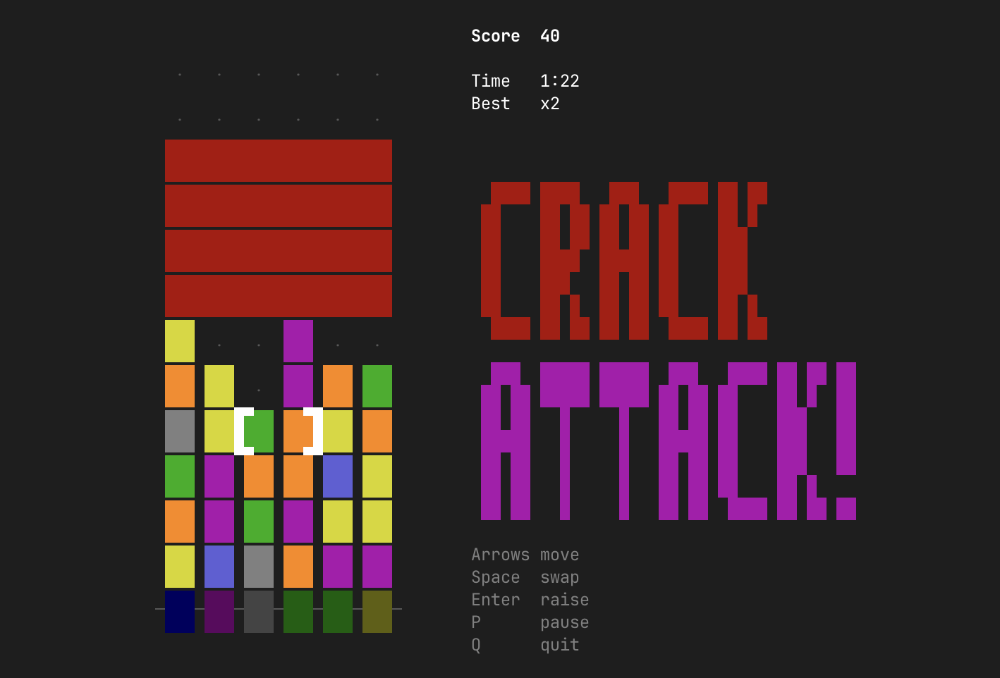
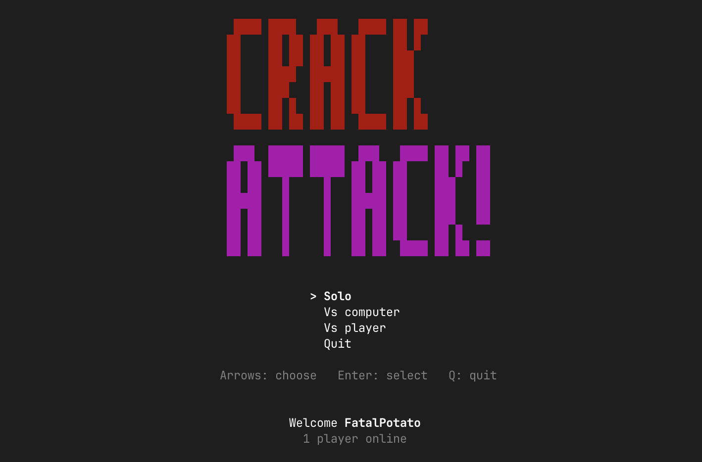
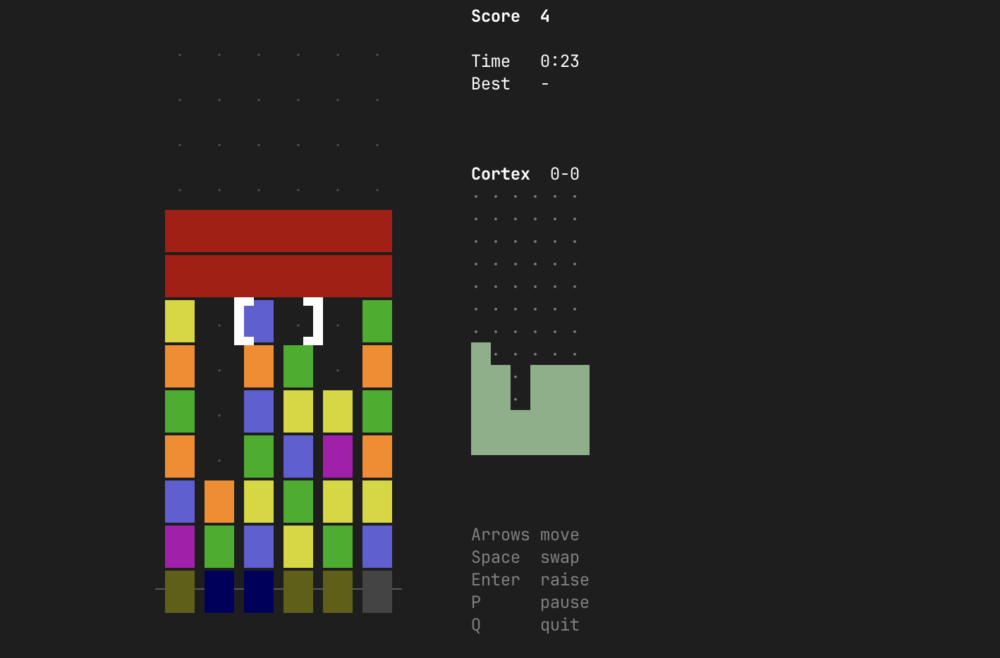
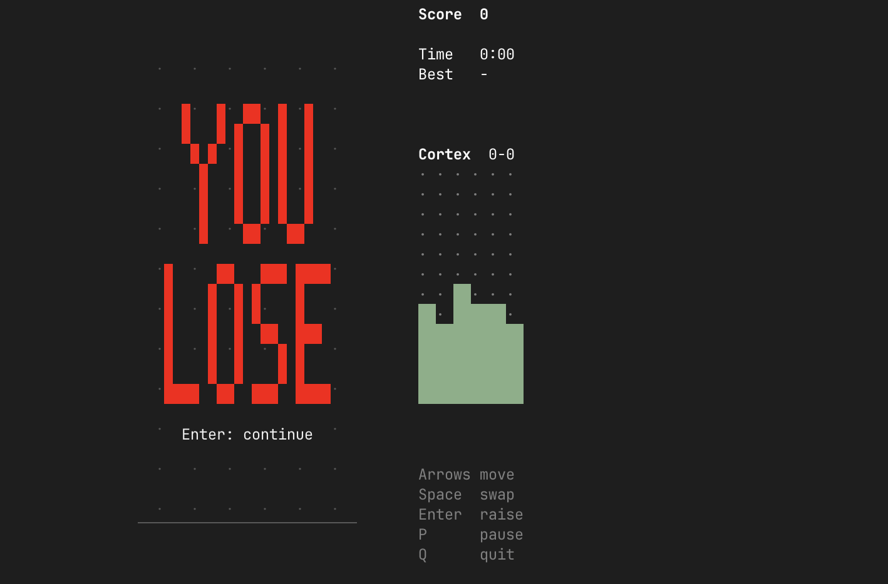

# Crack Attack! over ssh

A Docker image that serves the terminal version of
[Crack Attack!](https://github.com/thiosaur/crackattack) over ssh: connecting starts the game,
and nothing else is reachable.

This is the companion of the [main repository](https://github.com/thiosaur/crackattack), which
holds the game, its releases and the terminal version itself.

The image is only packaging. The game itself is downloaded from a release of the main
repository (one small executable) and checked against a pinned SHA-256 before it goes in.

```
ssh -p 2222 play@your-server
```

<p align="center">
  
</p>
<p align="center">
  
</p>
<p align="center">
  
  
</p>

## What you can play

- **Solo.**
- **Vs computer**, at three levels: easy, medium or hard.
- **Vs player**: a duel against another player connected to the same server.

## A personal server, not a public service

This image is meant for your own machine: a homelab, a home server, a few people you know.
**It is not designed to be offered to the public.** Nothing in it deals with load or abuse:
there is no limit per address, no queue, no banning. The only limit is a plain total, `MAX_PLAYERS`
games at once (10 by default), and the container's `pids_limit`, `mem_limit` and `cpus`, which
only keep a mistake from taking the host down. Keep the port on your own network, or behind a VPN;
for a friend who comes from outside, use an invitation (see Invitations) rather than opening the
server to everyone.

For the same reason, with nothing configured, nobody can play: you say whose keys are allowed (below).

## Requirements

Docker with Compose, on an x86_64 machine: the game that goes in the image is the x86_64 build. On
ARM (a Raspberry Pi, for instance) the image builds but the game does not start. The player's
terminal must be at least 80x24.

## Run it

```sh
docker compose up -d --build
```

The players' keys are **the files of a directory**, `./keys` by default (any file in it, one public
key per line; a name that starts with a dot is not a key). The server reads the directory at each
login, so a file added, edited or removed counts at once, with no restart. A directory with no key
starts the container all the same, and nobody can play until a key is in it.

```sh
mkdir -p keys && cat ~/.ssh/id_ed25519.pub > keys/me    # then: docker compose up -d --build

# another directory (a path on the machine that runs docker)
KEYS_DIR=/srv/crackattack/keys docker compose up -d --build

# the keys you give, instead of the directory (one per line)
AUTHORIZED_KEYS="$(cat ~/.ssh/id_ed25519.pub)" docker compose up -d --build

# anyone who reaches the port, no password asked: only on a network you trust
AUTH_MODE=open docker compose up -d --build
```

A key is one line in the OpenSSH format (`ssh-ed25519 AAAA... comment`), as in `~/.ssh/id_ed25519.pub`.

Use a directory made for the game, rather than the `~/.ssh` of an account: what may log in to a
machine and what may play are two different rights.

To let someone else play, put their public key in another file of the directory. A key file that
starts with `---- BEGIN SSH2 PUBLIC KEY ----` is not read by sshd: convert it with
`ssh-keygen -i -m RFC4716 -f key.pub > keys/name`.

Open access is never chosen for you: it takes `AUTH_MODE=open`, and the container says so in
its log when it starts.

| Variable | Default | Meaning |
|---|---|---|
| `AUTH_MODE` | `keys` | `keys`, or `open` to let anyone in |
| `KEYS_DIR` | `./keys` | directory of the players' public keys, on the docker host |
| `AUTHORIZED_KEYS` | | allowed public keys given directly; replaces the directory |
| `IMPORT_KEYS_FILE`, `IMPORT_KEYS_FILE_2` | | files of public keys to copy into the directory, once (see Import) |
| `IDLE_TIMEOUT` | `300` | seconds without a key press before the game stops |
| `MAX_TIME` | `1800` | seconds of play per connection |
| `MAX_PLAYERS` | `10` | games at once; a further connection is told the server is full |
| `COMPACT` | `0` | `1`: the game draws the compact 80x24 screen (it is chosen by itself when the terminal is short) |
| `INVITES` | `0` | `1`: a player with a key is shown a command to give a friend (see Invitations) |
| `INVITE_HOST` | | the name of this server as your friends reach it, written in that command |
| `INVITE_PORT` | `2222` | the port of this server as your friends reach it (`HOST_PORT` unless something redirects it), written in that command |
| `PIDS_LIMIT` | `128` | processes the container may run (about 5 per player; raise it with `MAX_PLAYERS`) |
| `HOST_PORT` | `2222` | port published on the host |
| `BIND_ADDRESS` | `0.0.0.0` | address the port is published on; give your LAN address to keep it off other networks |

A wrong value stops the container at start, with a message.

With a remote docker engine (`docker context`), `KEYS_DIR` and the import files are paths on the
engine's machine, not on the one where you type the command.

### Invitations

With `INVITES=1`, a player who logs in with a key is shown, on the Vs player page, a command to give to a friend, such as `ssh -p 2222 invite-k3x9q0zv7a@game.example.org`.
The friend types it and plays, with no key and no password, under a nickname like everybody.

**Give the name of the server:** the container does not know the name or the port under which you
are reached, so set `INVITE_HOST` (and `INVITE_PORT` if the published port is not 2222). Without
`INVITE_HOST` the command ends with `@<server>`, and the container says so when it starts.

- An invitation lasts 24 hours and renews itself: the command shown stays valid for at least 12
  hours.
- Only players with a key see the command, not invited players.
- It opens the game and nothing else, and counts in `MAX_PLAYERS`.
- Invitations live in memory: restarting the container cancels the ones in progress.
- The invitation is a secret that ends up in the server's log and the friend's terminal history:
  that is acceptable for something that only opens a game and expires.
- Without `INVITES=1`, no account but `play` can log in.

### Import

To start from the keys of an account (say `~/.ssh/authorized_keys`), name the file once:

```sh
IMPORT_KEYS_FILE=$HOME/.ssh/authorized_keys docker compose up -d --build
IMPORT_KEYS_FILE=/root/.ssh/authorized_keys IMPORT_KEYS_FILE_2=/home/me/.ssh/authorized_keys docker compose up -d --build
```

- It runs once, at the first start only: later starts do nothing, even if the setting is still there.
- It is a copy, not a link: a key removed later from the source file keeps working until you remove
  it from the directory too.
- To import again, delete the `.already-imported` file in the directory.

## Before you expose it

**Docker and your firewall.** A port published by Docker goes around `ufw` and most host firewalls:
with `BIND_ADDRESS` at its default `0.0.0.0`, the port is open to every network the machine is on,
whatever `ufw status` says. Set `BIND_ADDRESS` to the address of the network that should reach it
(your LAN or VPN address), or filter in the `DOCKER-USER` chain.

**Keep it up to date.** Nothing rebuilds the image by itself: a flaw of OpenSSH fixed by Debian
stays in the container until you rebuild it. From time to time (and when Debian announces an
OpenSSH security fix):

```sh
docker compose build --pull && docker compose up -d
```

The ssh host key is kept in the `host-keys` volume, so the fingerprint survives a rebuild. It is
printed in the container's log when it is created.

## On Coolify

`compose.coolify.yml` is the variant for Coolify; its header says how to set it up.

## Security

- One account for the players, `play`, plus the invitation accounts if you turn them on. Whatever
  the client asks for (`ssh play@host ls`, `sftp`...), it only starts the game.
- No forwarding of any kind, no shell, no root login. sshd runs as `play` itself, and each key is
  restricted to a terminal.
- The container has a read-only root file system, no capability at all, and only a read-only view
  of the directory of keys, never the host's `~/.ssh`.
- sshd is cut down to what the game uses: modern algorithms only, public keys only (in keys mode),
  no sftp. A connection that opens no game is closed after 30 seconds.
- A connection without a terminal is refused. Beyond `MAX_PLAYERS`, the server says it is full.
- A player who stops pressing keys, or plays too long, is disconnected; a dropped connection ends
  the game.
- sshd logs each connection with the player's address and which key was used. The container log is
  capped (3 files of 10 MB) and is lost with the container.

## Sizing

Each connection runs a game at 50 frames per second: about 1.5 % of one CPU core, 5 MiB and 5
processes per player (14 % of a core and 49 MiB for ten players). Size `PIDS_LIMIT`, `mem_limit`,
`cpus` and `MAX_PLAYERS` for the number of players you expect.

## Which release

`.env` pins the release (`CRACKATTACK_VERSION`, `CRACKATTACK_ARCHIVE`, `CRACKATTACK_SHA256`).
To move to a new one:

```sh
tools/bump.sh 2.0.0-beta.7                       # the static build; reads the checksum from SHA256SUMS
tools/bump.sh 2.0.0-beta.7 linux-x86_64          # the ordinary build instead (needs glibc 2.34 or later)
docker compose up -d --build
```

The image needs 2.0.0-beta.7 or later, and does not start the game with an older release.

## Test

```sh
test/smoke.sh                                  # the release pinned in .env
test/smoke.sh /path/to/crackattack/checkout    # the game built from a checkout, to try a change
```

It builds the image, starts it with the hardening of `compose.yml` and checks, over ssh, that the
game starts and stops, that nothing else can be run, that the settings are enforced, and who gets
in. It removes everything it created.

## Licence

The game is free software, GPL-3.0-or-later; the image carries `LICENSE`, `AUTHORS` and the
third-party notices under `/usr/share/doc/crackattack-terminal/`, and the ssh banner points to the
source. This repository uses the same licence (see `LICENSE`).
